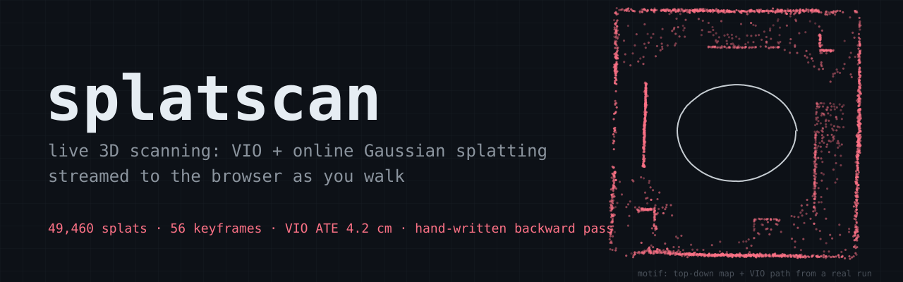
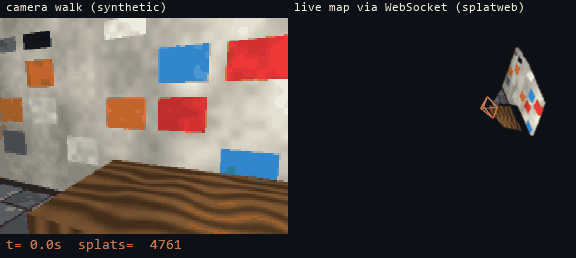
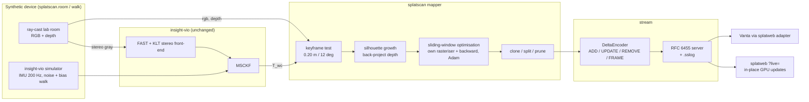
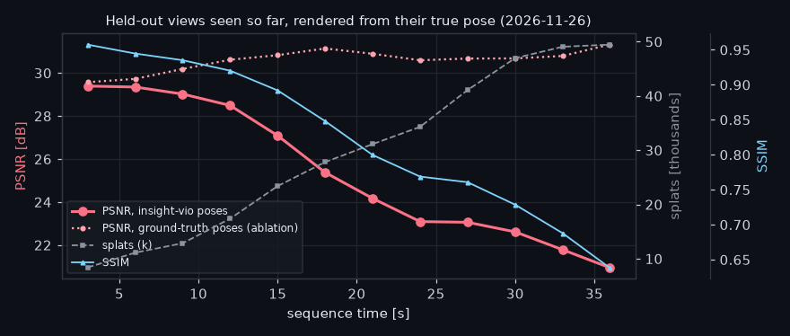
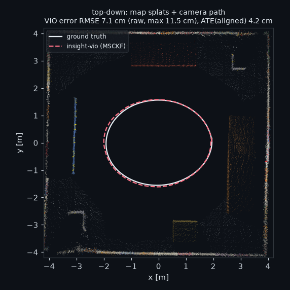

<p align="center">
  
</p>

<p align="center">
  <a href="https://github.com/coopersimpson101-debug/splatscan/actions/workflows/ci.yml"></a>
  <a href="https://github.com/coopersimpson101-debug/splatscan/releases/latest"></a>
  <a href="LICENSE"></a>
  
  
  
</p>

**A live 3D scanner, end to end:** insight-vio tracks the camera from stereo images and an IMU,
an online Gaussian-splatting optimiser (with its own tile-based rasteriser and a hand-derived
backward pass) grows the map keyframe by keyframe, and every change is streamed over a
WebSocket into [splatweb](https://github.com/coopersimpson101-debug/splatweb)'s GPU buffers while
you walk. Everything here runs on a synthetic lab walk; the Jetson build is wired but not yet
validated.

<p align="center">
  <a href="#quickstart">Quickstart</a> ·
  <a href="#how-it-works">How it works</a> ·
  <a href="#results">Results</a> ·
  <a href="#status">Status</a> ·
  <a href="docs/derivation.md">Backward-pass derivation</a> ·
  <a href="docs/protocol.md">Stream protocol</a> ·
  <a href="docs/jetson.md">Jetson deployment</a>
</p>

<p align="center">
  
</p>
<p align="center"><sub>Real output, 2026-11-26. Left: the synthetic head-mounted camera walking a 36 s
loop through a procedurally textured lab (every 12th frame, played at 2.5x speed). Right: the map as a client
received it, rendered at each frame marker by splatweb's live loader through Dawn on an RTX 2060
(<code>scripts/live_capture.ts</code> in splatweb), ceiling cropped, the pink frustum is the
insight-vio pose. Mapping ran on the CPU and is <b>not</b> real time (see Results).</sub></p>

## Highlights

- **Own differentiable rasteriser**: EWA projection, tile binning with `(tile, depth)` sort keys,
  front-to-back compositing with the 3DGS cut-offs, all vectorised in PyTorch with a segmented
  log-transmittance prefix sum; device-agnostic (CPU and CUDA both tested here).
- **Hand-derived backward pass** for means, scales, rotations, opacity, SH colour (degree 0-3, incl.
  the view-direction term) and rendered depth. It matches autograd on an independent dense
  reference to 1e-7 in 12 configurations and passes `torch.autograd.gradcheck`.
- **Online mapping** from VIO poses: motion-based keyframes, SplaTAM-style silhouette growth from
  depth, a sliding window of 8 keyframes plus random older ones, clone/split/prune, and a
  hand-written Adam with per-splat step counts (so splats born late get correct bias correction).
- **Measured here (🧪 synthetic)**: 36 s walk, 720 frames, 56 keyframes, 49,460 splats. insight-vio
  ATE 4.2 cm. Held-out PSNR at the end: 27.6 dB rendered from the VIO pose, 21.0 dB from the true
  pose. With ground-truth poses the same mapper holds 31.3 dB, so tracking drift is the dominant error.
- **Incremental stream protocol** (documented, versioned) with a delta encoder, a hand-written RFC 6455
  WebSocket server, late-joiner snapshots and `.sslog` record/replay.
- **splatweb `?live=ws://...`**: splats are appended, updated and swap-removed in the GPU buffers in
  place, with GPU-side buffer growth. A Dawn test checks the buffers are byte-identical to a full upload.
- **44 Python tests + 71 splatweb tests**, all passing on this machine.

## Status

| Item | State | Evidence |
|---|---|---|
| Rasteriser forward + hand-derived backward (means, scale, rotation, opacity, SH 0-3, depth) | ✅ | `tests/test_raster_grad.py`: 12 autograd comparisons, finite-difference gradcheck, clamp branch, CUDA vs CPU |
| Per-splat Adam, densify / prune, `.ply` export / import | ✅ | `tests/test_mapping.py` |
| Online mapper (keyframes, growth from depth, sliding window) | ✅ | unit tests + the run below |
| insight-vio on rendered stereo images + IMU | 🧪 | synthetic only: ATE 4.2 cm over a 36 s walk |
| Map quality on held-out views | 🧪 | synthetic lab, see Results |
| Sparse depth from insight-vio stereo matches (no depth sensor) | 🧪 | DLT triangulation, median depth error < 5 % in tests; not used in the headline run |
| Stream protocol v1, delta encoder, WebSocket server, replay | ✅ | `tests/test_protocol.py` (incl. a real socket round trip) |
| splatweb live loader `?live=` (branch `feat/live-stream`) | ✅ | 10 unit tests, 1 Dawn GPU test, used for the hero GIF |
| `?live=` in an interactive browser | 🧪 | opened in the desktop app's Chromium WebGPU pane against the replay server (2026-11-26): map grows in place, overlay ~63 FPS, no console errors; other browsers not tried |
| Real-time mapping | ❌ | CPU: 1.38 s per iteration on this loaded desktop; CUDA (RTX 2060): 0.30 s |
| Jetson config, systemd unit, camera/IMU wiring to insight-vio's `hw` layer | ⏳ | `deploy/jetson/`, `splatscan/hw.py`; only the dry run is tested |
| Vanta | ⏳ | via splatweb's adapter contract (`docs/vanta-integration.md` there); not connected |
| Lab-walk video (real camera, side by side) | ⏳ | needs the hardware |

## Quickstart

```bash
git clone https://github.com/coopersimpson101-debug/splatscan && cd splatscan
pip install torch --index-url https://download.pytorch.org/whl/cpu && pip install -e ".[dev,figures]"
python -m pytest -q                                            # 44 tests, about 3-5 min on CPU
python -m splatscan.record --duration 36 --out runs/walk.npz   # VIO on the rendered walk (slow: numpy front-end)
python scripts/run_scan.py --recording runs/walk.npz --out runs/scan --serve 8765   # then open splatweb ?live=ws://127.0.0.1:8765
```

`pip install -e .` pulls insight-vio from GitHub (`git+https://github.com/coopersimpson101-debug/insight-vio`).

<details>
<summary><b>More: replay, headless capture, figures, ablations</b></summary>

```bash
# replay a finished scan to any number of viewers (each gets it from the start)
python -m splatscan.server --replay runs/scan/stream.sslog --port 8765 --speed 1 --loop
# in a splatweb checkout (branch feat/live-stream): render the stream headless with Dawn
npm run live:capture -- --url ws://127.0.0.1:8765 --out runs/scan/live --clip -5,-5,-1,5,5,2.6 --eye 0,-6.8,7.2 --fov 52
# ground-truth-pose ablation (isolates mapping from tracking), on a GPU if you have one
python -m splatscan.record --duration 36 --gt-poses --out runs/walk_gt.npz
python scripts/run_scan.py --recording runs/walk_gt.npz --out runs/scan_gt --device cuda
# offline evaluation of a finished map at true and at VIO poses
python scripts/eval_map.py --run runs/scan --recording runs/walk.npz
# README figures + banner (banner.png needs: npm i @resvg/resvg-js)
python scripts/make_figures.py --run runs/scan --live runs/scan/live --out docs/assets --compare runs/scan_gt
node scripts/render_banner.mjs
# regenerate the protocol fixture used by splatweb's tests
python scripts/make_protocol_fixture.py --out ../splatweb/tests/fixtures
```

</details>

## How it works



<details>
<summary><b>Repository layout</b></summary>

```
splatscan/
  raster.py       tile-based differentiable rasteriser, hand-written backward, dense reference
  sh.py           real SH basis up to degree 3 + Jacobians
  gaussians.py    the map: parameters, ids, growth from depth, densify / prune, export
  optim.py        Adam with per-splat state that survives resizing
  mapper.py       keyframes, sliding window, losses, evaluation
  losses.py       L1 + SSIM, PSNR
  room.py         procedural lab room ray-caster (RGB + depth)
  walk.py         head-mounted walk trajectory for insight-vio's simulator
  vio_source.py   insight-vio VioSystem fed with rendered stereo images + simulated IMU
  record.py       cache a VIO run; CachedSource replays it
  triangulate.py  sparse depth from insight-vio stereo matches
  protocol.py     stream protocol v1, DeltaEncoder, .sslog
  ws.py           hand-written WebSocket framing / handshake
  server.py       live StreamServer and replay server
  hw.py           Jetson device source (insight-vio hw layer + colour camera), untested
  export.py       3DGS .ply writer / reader
scripts/          run_scan.py, run_device.py, eval_map.py, make_figures.py, make_protocol_fixture.py
deploy/jetson/    device config + systemd unit
docs/             derivation.md, protocol.md, jetson.md
```

</details>

### 1. The forward model

Each splat is a 3D Gaussian with mean `μ`, covariance `Σ = R(q) S Sᵀ R(q)ᵀ` (`S = diag(eˢ)`),
opacity `σ(ℓ)` and view-dependent colour from real spherical harmonics. Projecting with the
camera rotation `W` and the Jacobian `J` of the pinhole map gives the screen-space covariance of the
EWA approximation [Zwicker et al. 2002], as in 3D Gaussian Splatting [Kerbl et al. 2023]:

    Σ' = J W Σ Wᵀ Jᵀ + 0.3 I,     α_i = min(0.99, o_i exp(−½ Δᵀ Σ'⁻¹ Δ))

Pixels composite front to back, `C = Σ_i f_i α_i Π_{j<i}(1 − α_j) + T_N·bg`, where `f_i` is the SH
colour and also the camera depth, so the same pass renders an expected-depth image for the
depth loss. The reference CUDA renderer loops over pixels in a tile; here every (splat, tile) pair
becomes a row of a `(pairs, tile²)` tensor, sorted by `(tile, depth)`, and transmittance is a
**segmented exclusive prefix sum of `log(1 − α)`** (float64) along the pair axis. The 1/255 alpha
cut-off and the `T < 10⁻⁴` early stop are reproduced exactly.

### 2. The backward pass

`torch.autograd` is not used for the rasteriser: `_RasterizeFn.backward` implements the chain rule
by hand, stage by stage. The key step is the compositing gradient,

    ∂L/∂α_i = T_i (f_i · g) − S_i / (1 − α_i),    S_i = Σ_{j>i} w_j (f_j · g) + T_N (bg · g),

where `S_i` comes from the same segmented prefix sums. Then the 2D Gaussian (`u, v` and the conic),
the matrix inverse (`dQ = −Q dΣ' Q`), the EWA Jacobian including the frustum-clamp branch (exact in
both branches), the quaternion → rotation derivatives, the opacity
sigmoid and the SH basis with its direction term back into the mean. The full derivation is in
[docs/derivation.md](docs/derivation.md). Verification: float64, 37×29 px, 40 splats, SH degree
0/1/2/3 × tile 4/8/16, forward equal to the dense reference to 1e-10 and every gradient to
`rtol 1e-7`; `gradcheck` with central differences; and a CUDA run matching CPU.

### 3. Online mapping

Poses come from VIO and are not refined by the map (tracking and mapping are decoupled, like a
VIO + dense mapping back-end rather than a full Gaussian SLAM such as SplaTAM [Keetha et al. 2024]
or MonoGS [Matsuki et al. 2024], which also optimise poses through the rasteriser).

* **Keyframes**: when the camera has moved 0.20 m or turned 12° since the last one.
* **Growth**: render the map at the keyframe; where accumulated opacity < 0.5, or the measured depth
  is > 15 % in front of the rendered surface, back-project every second pixel into an isotropic splat
  with σ = 0.6 · 2 · depth / f (its footprint), opacity 0.5 and the pixel's colour (SplaTAM's idea).
* **Optimisation**: 20 iterations per keyframe (60 for the first). A third of them use the new
  keyframe, the rest sample the window of the 8 most recent keyframes, with probability 0.25 an older
  one (limits forgetting). Loss `0.8·L1 + 0.2·(1 − SSIM) + 0.1·|D − D_obs·A|`.
* **Densify / prune** every 2 keyframes: splats whose mean screen-space gradient exceeds 2e-5 are
  cloned (small) or split into two samples with scale/1.6 (larger than 5 cm). Splats with opacity
  < 0.01 or scale > 0.5 m are dropped.
* **Adam per parameter group** (means, log-scales, quaternions, opacity logits, SH DC, SH rest) with a
  per-splat step counter, and rows that got no gradient this step are skipped entirely.

Depth for seeding is the renderer's depth with 1 % noise, standing in for a stereo/ToF depth module.
For a device without a depth sensor, `splatscan/triangulate.py` triangulates insight-vio's own
stereo matches into a sparse depth map (tested, not yet used for a full run).

### 4. Streaming

After each keyframe the map is diffed against what clients hold: new ids are ADDed, vanished ids
REMOVEd, survivors UPDATEd only when they changed visibly (2 mm, 3 % scale, 0.02 opacity/colour). A
FRAME marker every 4 frames carries the device pose. Clients joining late get a snapshot first;
the server's registration and broadcast share a lock with per-client FIFOs, so nothing is missed.
In splatweb, `LiveScene` keeps dense slots (swap-remove), coalesces dirty slots into ranges and
`flushLiveScene()` uploads only those, growing GPU buffers with a GPU-side copy when needed. The
wire format is in [docs/protocol.md](docs/protocol.md).

## Results

All numbers below are from runs on 2026-11-26 on this machine: AMD Ryzen 5 3600 (6C/12T), 16 GB,
NVIDIA RTX 2060, Windows 10, PyTorch 2.14. **The machine was heavily shared with other jobs while
these ran** (CPU at 100 %), so absolute timings are pessimistic and noisy; quality numbers are not
affected. Synthetic data only (🧪).

<p align="center">
  
</p>
<p align="center">
  
</p>

**Run** (`scripts/run_scan.py`, defaults): 36 s walk at 20 Hz = 720 frames, 36 held out (every 20th,
never used for mapping), map at 160×120 (the VIO runs on 320×240 stereo), SH degree 1.

| | insight-vio poses (CPU) | ground-truth poses (CUDA ablation) |
|---|---:|---:|
| keyframes / iterations | 56 / 1,160 | 55 / 1,140 |
| final splats (cloned / split / pruned over the run) | 49,460 (6,053 / 506 / 3) | 46,690 (3,865 / 339 / 0) |
| held-out PSNR / SSIM, rendered from the **true** pose | **21.0 dB / 0.639** | **31.3 dB / 0.961** |
| held-out PSNR / SSIM, rendered from the **VIO** pose | **27.6 dB / 0.890** | (same as above) |
| held-out PSNR (views seen so far) at t = 3 s → 12 s → 24 s → 36 s | 29.4 → 28.5 → 23.1 → 21.0 dB | 29.6 → 30.6 → 30.6 → 31.3 dB |
| VIO position error vs ground truth | raw RMSE 7.1 cm (max 11.5 cm); ATE after SE(3) alignment 4.2 cm (max 6.3 cm) | 0 |
| mapping time per keyframe (median) / per iteration | 27.6 s / 1.38 s | 3.8 s / 0.30 s |
| VIO (numpy FAST/KLT + MSCKF) per frame | 712 ms | not run |
| end-to-end wall time / real-time factor | 1,835 s / 0.020× | 406 s / 0.089× |
| streamed: messages, bytes, splat records (add / update / remove) | 440, 41.2 MiB, 49,966 / 400,218 / 506 | 425, 38.0 MiB |

What this says, honestly:

* The mapper itself is good: with exact poses it holds ~31 dB on unseen views for the whole walk.
* With insight-vio poses the map is consistent in its own frame (27.6 dB from the VIO pose), but
  the 4-11 cm of drift accumulated during the walk misaligns it with the true geometry, so the
  standard "render from the true pose" metric falls to 21 dB. Pose refinement through the
  rasteriser (as in SplaTAM / MonoGS) or loop closure is the obvious next step (roadmap).
* It is not real time: the PyTorch rasteriser launches hundreds of small kernels per iteration and
  this CPU was saturated by other jobs. See [docs/jetson.md](docs/jetson.md) for the budget a device
  build has to meet.
* Updates dominate the stream (8× more UPDATE records than ADDs), because splats keep being
  optimised after they are first sent.

**Tests** (2026-11-26): `python -m pytest -q` → 44 passed (incl. the CUDA comparison, which skips
without a GPU). splatweb on `feat/live-stream`: `npm test` → 9 files, 71 passed (6 run real WGSL
through Dawn on the RTX 2060), plus `npm run typecheck` and `npm run build`.

## Hardware validation / TODO for the author

Everything below needs the real device and has **not** been done. Commands and empty tables are
ready; details in [docs/jetson.md](docs/jetson.md).

| Check | Command | Result |
|---|---|---|
| Wiring dry run on the Jetson | `python scripts/run_device.py --config /etc/splatscan/splatscan.yaml --dry-run` | ⏳ |
| insight-vio alone on the device | insight-vio `scripts/run_live.py --config /etc/splatscan/vio.yaml` | ⏳ |
| Colour camera + Kalibr `T_imu_rgb` | `gst-launch-1.0 nvarguscamerasrc sensor-id=2 ! fakesink`, Kalibr | ⏳ |
| Scanner as a service | `sudo systemctl enable --now splatscan && journalctl -u splatscan -f` | ⏳ |
| Browser receives the live map | splatweb `?live=ws://10.0.0.42:8765` | ⏳ |
| Vanta shows the live map | splatweb adapter + `flushLiveScene()` per frame | ⏳ |
| Lab-walk side-by-side video | screen-record splatweb + phone video of the walk | ⏳ `docs/assets/lab_walk.mp4` |

| Measured on Orin Nano | Value |
|---|---|
| VIO ms / frame (640×400 stereo) | ⏳ |
| mapping ms / iteration (CUDA, 320×240) | ⏳ |
| keyframes per second sustained | ⏳ |
| splats after a 60 s lab walk | ⏳ |
| held-out PSNR (frames skipped from mapping) | ⏳ |
| stream bandwidth (MB/s) | ⏳ |

## Roadmap

- Pose refinement through the rasteriser (`∂L/∂T_cw`) and keyframe-pose graph updates from VIO
- A fused CUDA/Triton kernel for the per-tile loop (the vectorised PyTorch version is launch-bound)
- f16 splat records and quantised SH in the stream (halves the bandwidth)
- Full run with sparse stereo-feature depth only (no depth sensor), compared with dense depth
- Exposure / white-balance compensation for real cameras
- Run on the Jetson and fill in the tables above

## References

- B. Kerbl, G. Kopanas, T. Leimkühler, G. Drettakis. *3D Gaussian Splatting for Real-Time Radiance Field Rendering.* ACM TOG (SIGGRAPH) 2023.
- M. Zwicker, H. Pfister, J. van Baar, M. Gross. *EWA Splatting.* IEEE TVCG 2002.
- N. Keetha, J. Karhade, K. M. Jatavallabhula, G. Yang, S. Scherer, D. Ramanan, J. Luiten. *SplaTAM: Splat, Track & Map 3D Gaussians for Dense RGB-D SLAM.* CVPR 2024.
- H. Matsuki, R. Murai, P. H. J. Kelly, A. J. Davison. *Gaussian Splatting SLAM.* CVPR 2024.
- A. I. Mourikis, S. I. Roumeliotis. *A Multi-State Constraint Kalman Filter for Vision-aided Inertial Navigation.* ICRA 2007 (the filter inside insight-vio).
- D. P. Kingma, J. Ba. *Adam: A Method for Stochastic Optimization.* ICLR 2015.
- Z. Wang, A. C. Bovik, H. R. Sheikh, E. P. Simoncelli. *Image Quality Assessment: From Error Visibility to Structural Similarity.* IEEE TIP 2004.

Downloaded for this project: nothing except PyPI/npm packages (PyTorch, numpy, PyYAML, matplotlib,
Pillow, pytest; `@resvg/resvg-js` from npm for the banner PNG). insight-vio is used from its own
repository, unmodified.

## License

MIT, see [LICENSE](LICENSE). Copyright (c) 2026 the splatscan authors.
