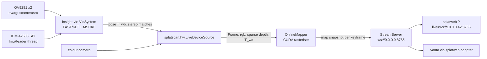

# Jetson deployment (⏳ not validated on hardware)

Everything in this document is a plan plus untested wiring. Nothing here has run on a Jetson.
The files are `deploy/jetson/splatscan.yaml`, `deploy/jetson/splatscan.service`,
`splatscan/hw.py` and `scripts/run_device.py` (`--dry-run` works on any machine and is tested).

## Hardware

| Part | Role | Notes |
|---|---|---|
| Jetson Orin Nano 8 GB (JetPack 6) | compute | PyTorch for JetPack provides CUDA; the rasteriser is device-agnostic (`--device cuda`) |
| 2 × OV9281 global-shutter mono, CSI 0/1 | VIO stereo pair | exactly insight-vio's Jetson config (`configs/jetson_orin_icm42688.yaml` there) |
| ICM-42688-P on SPI0 CS0 | IMU | insight-vio `hw/imu_spi.py` driver, `ImuReader` thread at 400 Hz |
| colour camera (e.g. IMX219/IMX477), CSI 2 or USB | splat colour | rigidly mounted; `T_imu_rgb` from Kalibr |
| optional depth camera | splat seeding | otherwise `depth.mode: stereo_features` triangulates insight-vio's stereo matches |

## Data flow on the device



## Install (to be verified)

```bash
sudo useradd -r -G gpio,i2c,video splatscan
sudo mkdir -p /opt/splatscan /etc/splatscan && sudo chown splatscan /opt/splatscan
git clone https://github.com/coopersimpson101-debug/splatscan /opt/splatscan
python3 -m venv --system-site-packages /opt/splatscan/venv      # reuse JetPack's PyTorch + OpenCV
/opt/splatscan/venv/bin/pip install -e /opt/splatscan "insight-vio @ git+https://github.com/coopersimpson101-debug/insight-vio"
sudo cp /opt/splatscan/deploy/jetson/splatscan.yaml /etc/splatscan/
sudo cp <calibrated insight-vio config> /etc/splatscan/vio.yaml
/opt/splatscan/venv/bin/python /opt/splatscan/scripts/run_device.py --config /etc/splatscan/splatscan.yaml --dry-run
sudo cp /opt/splatscan/deploy/jetson/splatscan.service /etc/systemd/system/
sudo systemctl daemon-reload && sudo systemctl enable --now splatscan
journalctl -u splatscan -f
```

## Performance budget (targets, not measurements)

Measured on the development desktop (see README Results) the mapper is far from real time on a
heavily loaded CPU; these are the numbers the Jetson has to hit for "scan while you walk":

| Stage | Rate | Budget per call | Measured on Orin Nano |
|---|---|---|---|
| IMU read + propagate | 400 Hz | < 0.5 ms | ⏳ |
| VIO front-end + MSCKF update (640×400 stereo) | 20 Hz | < 25 ms | ⏳ |
| Keyframe selection | 20 Hz | < 0.1 ms | ⏳ |
| Splat growth (render silhouette + back-project) | per keyframe (~2 Hz) | < 30 ms | ⏳ |
| Mapping iteration (forward + backward, 320×240, ~50k splats) | as many as fit | ~15 ms → ~30 it/s | ⏳ |
| Densify / prune | every 2 keyframes | < 20 ms | ⏳ |
| Snapshot diff + encode | per keyframe | < 10 ms | ⏳ |
| WebSocket send (LAN) | per keyframe | ~0.5-1 MB per keyframe at f32 | ⏳ |

Rules of thumb for getting there: run VIO and mapping in separate processes (the MSCKF must
never wait for the optimiser), pin the IMU thread, cap the splat count (e.g. 150k), cap
iterations per keyframe by wall-clock instead of count, and switch the record format to f16.

## Hardware validation checklist (for the author)

| Check | Command | Result |
|---|---|---|
| Config + wiring dry run | `python scripts/run_device.py --config /etc/splatscan/splatscan.yaml --dry-run` | ⏳ |
| IMU streams at 400 Hz | insight-vio `scripts/run_live.py` | ⏳ |
| VIO tracks (insight-vio alone) | insight-vio `scripts/run_live.py` | ⏳ ATE vs a tape-measured loop: ____ cm |
| Colour camera pipeline | `gst-launch-1.0 nvarguscamerasrc sensor-id=2 ! fakesink` | ⏳ |
| Kalibr `T_imu_rgb` | Kalibr camchain-imucam | ⏳ |
| Full scanner via systemd | `systemctl status splatscan` | ⏳ |
| Browser receives the live map | splatweb `?live=ws://10.0.0.42:8765` | ⏳ |
| Mapping iteration time (CUDA, Orin) | log lines `[kf ...] ... ms` | ⏳ ____ ms |
| Lab walk video (side-by-side) | screen-record splatweb + phone video of the walk | ⏳ |
